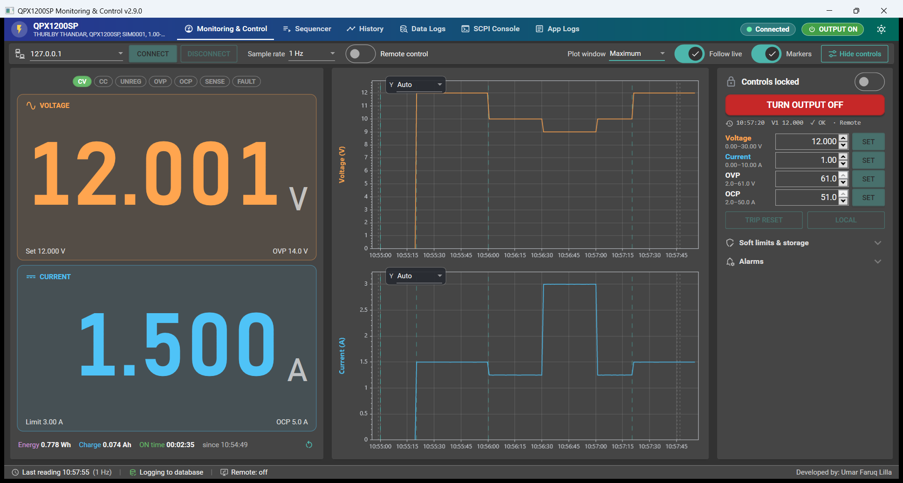
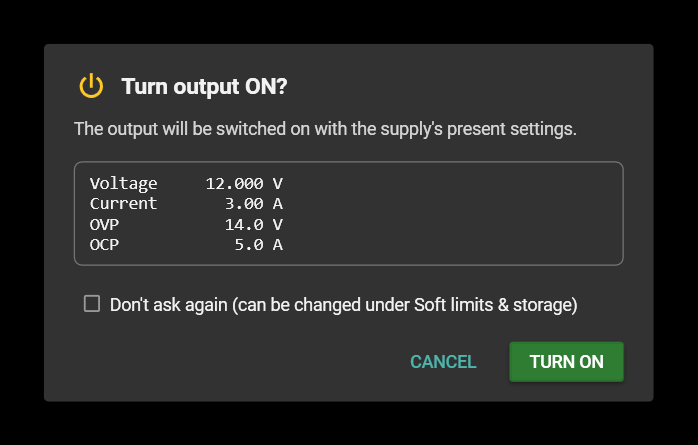
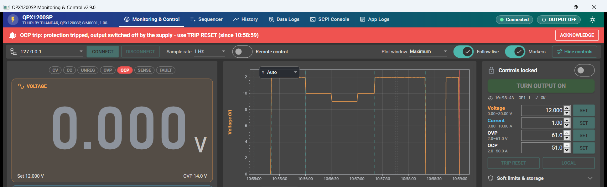
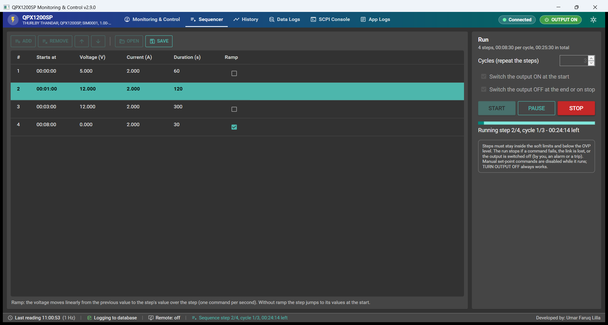
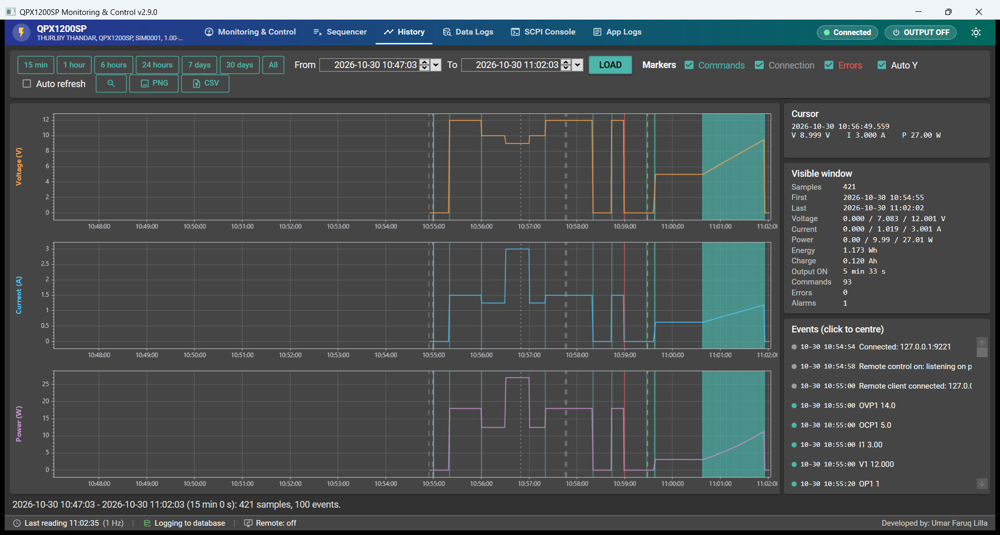
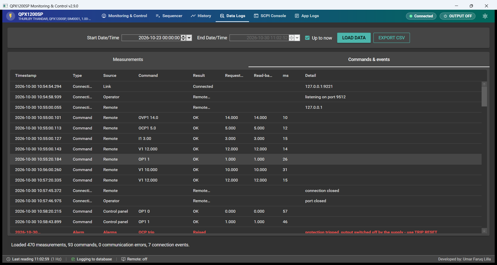
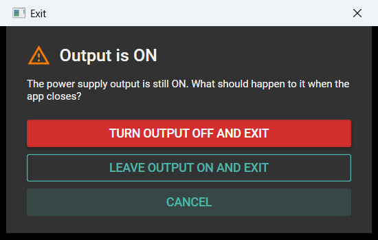

# QPX1200SP Monitoring & Control: User Guide

Version 2.9 · Developed by: Umar Faruq Lilla

This app monitors and controls an Aim-TTi **QPX1200SP** power supply (60 V, 50 A, 1200 W) over the network (LAN). It shows the output live in large digits and plots, logs every reading and every command to a database, and adds what the supply's own front panel does not have: a controls lock, a check of every setting with a read-back, alarms, a sequencer, history plots, and remote control by test software.

The screenshots in this guide were taken against the supply simulator, so the supply's identity in the header ends in `SIM0001`.

---

## Contents

1. [Before you start](#1-before-you-start)
2. [The main window](#2-the-main-window)
3. [Connecting to the supply](#3-connecting-to-the-supply)
4. [Safety features](#4-safety-features)
5. [Setting the output](#5-setting-the-output)
6. [Front panel: LOCAL](#6-front-panel-local)
7. [Live plots](#7-live-plots)
8. [Alarms](#8-alarms)
9. [Sequencer](#9-sequencer)
10. [History](#10-history)
11. [Data Logs](#11-data-logs)
12. [SCPI Console](#12-scpi-console)
13. [App Logs and trace](#13-app-logs-and-trace)
14. [Remote control by test software](#14-remote-control-by-test-software)
15. [Closing the app](#15-closing-the-app)
16. [Database, logs and settings](#16-database-logs-and-settings)
17. [Troubleshooting](#17-troubleshooting)
18. [Reference](#18-reference)

---

## 1. Before you start

**What you need**

- Windows 10 or 11 with .NET Framework 4.8.1 (included in current Windows 11; otherwise install it from Microsoft).
- A QPX1200SP connected to the same network as the PC, with a known IP address. The supply's IP address and network settings are set on the supply itself; see its instruction manual (LAN section). The app uses TCP port **9221**, the supply's standard port.

**Installing**

Copy the app folder (the one that holds `QPX1200SPController.exe`) to the PC, for example to `C:\Tools\QPX1200SP`. There is no installer. Start `QPX1200SPController.exe`.

The app keeps its files **next to the exe**, so put the folder somewhere you can write to (not under `C:\Program Files`):

| File or folder | What it is |
|---|---|
| `settings.xml` | Your settings (IP addresses, sample rate, soft limits, alarms, the sequence, theme). Saved when you change something. |
| `powerlog.db` | The database: every reading and every command with its result, connection events and alarms. |
| `Logs\` | Daily app log files (`app_yyyyMMdd.log`, kept 30 days) and, in `Logs\Trace\`, trace files. |

**First use on a real supply**

If the folder was used with the simulator before, delete `powerlog.db` and `settings.xml` first so the history and the soft limits do not come from test data.

---

## 2. The main window

The app opens maximized on the **Monitoring & Control** page.



From top to bottom:

- **Header bar**: the supply's identity (its `*IDN?` reply) once connected; the page buttons **Monitoring & Control**, **Sequencer**, **History**, **Data Logs**, **SCPI Console** and **App Logs**; on the right the connection chip (green Connected, amber while reconnecting, red when disconnected or failed), the **OUTPUT ON/OFF** chip, and the theme button (dark/light).
- **Alarm banner** (red, on every page) while an alarm has not been acknowledged ([section 8](#8-alarms)).
- **Connection bar**: IP address, CONNECT, DISCONNECT, Sample rate, Remote control ([section 14](#14-remote-control-by-test-software)); on the right the live plot settings (Plot window, Follow live, Markers) and **Hide controls / Show controls**.
- **Left**: the status chips (CV, CC, UNREG, OVP, OCP, SENSE, FAULT) and the measured **voltage** and **current** in large digits. Under each: the set voltage and OVP level, the current limit and OCP level, as read from the supply. At the bottom the session counters.
- **Middle**: the live voltage and current plots.
- **Right**: the control panel ([section 5](#5-setting-the-output)).
- **Status bar**: time of the last reading and sample rate, database status, remote control status, a running sequence, trace mode when on; on the right "Developed by: Umar Faruq Lilla".

The window title shows the app name and version, for example *QPX1200SP Monitoring & Control v2.9.0*. The column borders between meters, plots and control panel can be dragged; **Hide controls** gives the control panel's room to the meters and plots.

**Session counters** (under the meters): **Energy** (Wh) and **Charge** (Ah) delivered and **ON time** while the output was on, since the time shown. The button on the right resets them. Gaps of more than 10 s without readings are not counted.

---

## 3. Connecting to the supply

1. Type the supply's IP address in the IP box, or pick one of the last 8 addresses from its list. To use another port than 9221, type it after a colon, for example `127.0.0.1:9231`.
2. Choose a **Sample rate** (0.5, 1, 2 or 5 Hz). This is how often the output is read, shown and stored. 1 Hz is a good default for long runs.
3. Press **CONNECT**.

On connecting, the app reads the supply's identity and its set-points (voltage, current limit, OVP, OCP). The input boxes in the control panel take the supply's present values, so nothing changes on the supply just by connecting. The supply goes into Remote: its front panel is locked out while the app talks to it. The set-points under the meters are read again every 3 seconds, so a change made elsewhere shows up.

**If the link drops** (cable, network, supply switched off, no answer), the connection chip turns amber ("Link lost - reconnecting...") and the app reconnects by itself, waiting 1, 2, 5 and then 10 s between attempts, until you press DISCONNECT. While reconnecting, the controls are **locked** again, so nothing is changed by accident after an interruption. The plots leave a gap for the time without readings.

**DISCONNECT** stops reading the supply. It needs the controls unlocked (or the app to be reconnecting). The output stays as it is.

---

## 4. Safety features

### Controls lock

The control panel starts with **Controls locked**. Switch the lock (top of the control panel) on to change anything; it turns amber and reads **Controls unlocked**.

- The controls lock again after every TURN OUTPUT ON / OFF press, after a reconnect and after a disconnect.
- While locked, the SET buttons, TRIP RESET, LOCAL and DISCONNECT are disabled. The meters and plots keep running.

### Turning off is always allowed

**TURN OUTPUT OFF** works whenever the supply is connected, even with the controls locked, during a sequence and while a test program is connected. It never asks. Turning on needs the controls unlocked.

### Confirmation before turning on

TURN OUTPUT ON asks first and shows the supply's present set-points:



Tick **Don't ask again** to skip the question in future. Bring it back with **Ask before turning the output ON** under **Soft limits & storage**.

### Soft limits

Under **Soft limits & storage** you set a minimum and maximum for voltage and current, inside the supply's 0–60 V and 0–50 A. The voltage and current boxes, the SET buttons, the sequencer, the SCPI console and remote control only accept values inside these limits. The allowed range shows under each label in the control panel. Press **SAVE** to apply, **REVERT** to discard.

### Protection trips

The supply switches its output off itself on:

- **OVP**: the output voltage went above the OVP level.
- **OCP**: the output current went above the OCP level.
- **SENSE**: a fault on the remote sense connections.
- **FAULT**: an internal fault.

The matching chip turns red, a solid red line marks the moment on the live plots, and (with **On trips** ticked under Alarms) an alarm is raised. The app keeps the chip red until you press **TRIP RESET**, so a short trip is not missed. Remove the cause, unlock the controls and press **TRIP RESET**. A FAULT trip needs the supply's mains switched off and on.



### Power envelope

The QPX1200SP delivers up to 1200 W in any mix of voltage and current within 60 V and 50 A. If the load asks for more, the output goes **UNREG** (unregulated) and the UNREG chip lights.

---

## 5. Setting the output

Unlock the controls. The control panel has:

| Control | What it does |
|---|---|
| **TURN OUTPUT ON / OFF** | Switches the output. Turning on asks first (see above). The controls lock again afterwards. |
| Last command line | The last command sent to the supply from any part of the app, with its result (see below). |
| **Voltage** + SET | Sends the voltage set-point, within the soft limits. |
| **Current** + SET | Sends the current limit, within the soft limits. |
| **OVP** + SET | Over-voltage trip level, 2–61 V. |
| **OCP** + SET | Over-current trip level, 2–50 A. |
| **TRIP RESET** | Clears a latched OVP, OCP, sense or fault trip (`TRIPRST`). Remove the cause first. |
| **LOCAL** | Hands the supply back to its front panel ([section 6](#6-front-panel-local)). |
| **Soft limits & storage** | Soft limits, how long to keep logged data, and "Ask before turning the output ON". |
| **Alarms** | Alarm thresholds and actions ([section 8](#8-alarms)). |

A SET button is greyed out while its box holds a value outside the allowed range. Only one of the two folding sections is open at a time, so the panel fits the screen.

**Every setting is checked.** Each command goes to the supply in one exchange with an error query (`EER?`) and a read-back, for example `V1 12.000;EER?;V1?`. The result shows on the last command line under TURN OUTPUT ON/OFF:

- **✓ OK**: no error and the supply holds the value you sent.
- **⚠ Mismatch**: the supply answered but holds a different value (for example turning on a tripped output reads back as off; the line then adds "trip active - use TRIP RESET").
- **✗ Failed**: no answer, or the supply reported an error (for example error 200 when another interface has control). The line turns red.

Commands from elsewhere (Sequencer, Remote, Alarms, SCPI console) show their source after the result. Hover over the line to see the whole text. Every command and its result is also stored in the database.

Values are rounded to the supply's resolution before sending: 1 mV for voltage, 10 mA for current, 0.1 V for OVP, 0.1 A for OCP.

---

## 6. Front panel: LOCAL

While the app is connected the supply is in Remote: its knobs and keys do nothing.

**LOCAL** (controls unlocked) sends `LOCAL` and hands the front panel back. The app does not stop reading the supply, and the next reading puts it back in Remote. So to work on the front panel for longer, press **DISCONNECT** first and then **LOCAL** on the supply itself (or switch the supply off and on).

---

## 7. Live plots

The middle column shows the measured voltage (top) and current (bottom). Both share their time axis.

| Setting | What it does |
|---|---|
| **Plot window** | Time shown while following: 5, 10, 15 or 30 min, 1, 2, 3, 5 or 12 hours, 1 day, or **Maximum** (all readings kept). Picking one also turns Follow live on. |
| **Follow live** | The plots scroll with the newest reading at the right edge. Zooming or panning a plot turns it off, so the view stays where you put it while readings keep arriving. Turn it on again to follow. |
| **Markers** | Vertical lines for this session's events: commands (dashed), trips (solid red), alarms (dashed red, amber when cleared), connection events (dotted grey). Hover over one to see what it was and its result. Remembered between runs. |
| **Y** (top left of each plot) | **Auto**: from 0 up to the highest reading shown. **Signal**: fits the readings closely, to see ripple or drift. **Manual**: the range you type. |
| **Hide controls** | Gives the control panel's width to the meters and plots. |

**Mouse**: wheel to zoom, drag with the left button to pan, drag with the right button to zoom. Hover over a line to see the value and time.

The plots keep the last 24 hours of this session. Where no readings came in (link down, disconnected) the line stops rather than joining across the gap. For anything older, or from earlier sessions, use History.

---

## 8. Alarms

The **Alarms** section of the control panel watches the readings:

| Setting | What it does |
|---|---|
| **Voltage above / below**, **Current above / below**, **Power above** | Tick a rule and type its limit. Checked only while the output is on. |
| **Raise after (s)** | How long a value must stay beyond its limit before the alarm is raised (default 2 s). |
| **On trips** | Alarm on an OVP, OCP, sense or fault trip (on by default). |
| **On link loss** | Alarm when the link to the supply is lost (on by default). |
| **Play a sound** | A Windows sound when an alarm is raised (on by default). |
| **Output OFF** | A threshold alarm also turns the output off (software protection; off by default). |

When an alarm is raised:

- a red banner appears across every page; **ACKNOWLEDGE** hides it (the alarm itself stays active until its cause ends);
- the taskbar button flashes if the window is in the background;
- it is logged in the database (`Kind` = Alarm, `Result` = Raised) and drawn on the live plots and in History.

An alarm clears by itself when the value is back inside its limit (with a small margin, so a value sitting on the limit does not raise and clear repeatedly), when the output goes off, after TRIP RESET (trip alarms), when the link comes back (link alarm), or when you disconnect. Clearing is logged too (`Result` = Cleared). All settings are saved at once.

---

## 9. Sequencer

The **Sequencer** page runs a list of voltage and current steps, for example for a burn-in or a power-up profile.



**Steps**: each row has a voltage, a current limit, a duration in seconds and **Ramp**.

- Without Ramp, the step's values are sent at its start.
- With Ramp, the voltage moves linearly from the previous value to the step's value over the step's duration, one command per second.
- **ADD** inserts a step after the selected one; **REMOVE**, ↑ and ↓ edit the list. **Starts at** shows when each step begins.
- **OPEN** and **SAVE** read and write the steps as CSV (`Voltage,Current,DurationSeconds,Ramp`). The list is also kept in `settings.xml`.

**Run**: set **Cycles** (how often the steps repeat), **Switch the output ON at the start** and **Switch the output OFF at the end or on stop**, then press **START**. The app checks the sequence first and refuses to start if a step is outside the soft limits, at or above the OVP level, or shorter than 0.5 s or longer than 7 days. It warns (but starts) when a step's current is above the OCP level. It then asks for confirmation with the total time.

While it runs:

- the active step is highlighted, the progress bar and the status bar show the step, cycle and time left;
- **PAUSE** holds the present set-points and stops the step clock; **RESUME** continues;
- **STOP** ends the run;
- the manual SET buttons, TRIP RESET and LOCAL are disabled; setting commands in the SCPI console and remote `set` / `output on` are refused;
- **TURN OUTPUT OFF** still works, and ends the run.

The run stops by itself if a command fails, the link is lost, or the output goes off (by you, an alarm or a trip). Every command is logged with the source **Sequencer**.

---

## 10. History

The **History** page plots any time range from the database.



1. Press a preset (**15 min, 1 hour, 6 hours, 24 hours, 7 days, 30 days**, ending now, or **All**: first to last reading in the database). It loads at once. Or type **From** and **To** and press **LOAD**.
2. Read the plots: voltage, current and power, on one time axis.

What you see:

- Gaps where nothing was recorded (app closed, link down) stay empty.
- Up to 20,000 readings are drawn as they are. Longer ranges are drawn as the **minimum and maximum of each short time slice** (an envelope), so spikes and dips still show. The line under the plots says when this is the case.
- **Zoom and pan** with the mouse as on the live plots; the three plots move together. The window you are looking at is reloaded in full detail and the statistics are recalculated for it. The magnifier button goes back to the loaded range.
- **Markers**: tick **Commands**, **Connection** and **Errors** (failed or mismatched commands, communication errors, lost links, raised alarms). Hover over a marker for what happened.
- **Auto Y** fits the Y axes to the data after every zoom or pan.
- **Auto refresh** moves the window (same length) to end now every 5 seconds, so the page can stay open as a long-term live view. Zooming or panning switches it off.
- **Cursor** (right): time and values under the mouse.
- **Visible window** (right): number of readings, first and last, minimum / average / maximum of voltage, current and power, energy, charge, output ON time, commands, errors and alarms.
- **Events** (right): the commands and events in the window. Click one to centre the plots on it.

**PNG** saves the plots as an image. **CSV** saves every reading in the window shown (columns as under [Data Logs](#11-data-logs)).

---

## 11. Data Logs

The **Data Logs** page lists the database rows of a time range.



Pick **Start Date/Time** and **End Date/Time** (or tick **Up to now**), then press **LOAD DATA**.

- **Measurements**: every reading (timestamp, voltage, current, power, output on, CV, CC, UNREG and trip flags), 1,000 rows per page with page buttons.
- **Commands & events**: every command with its source, result, requested and read-back value and duration in ms, plus connection events and alarms. Failed rows are red, mismatches amber, raised alarms red and bold.

**EXPORT CSV** saves the tab shown, for the whole range:

| Tab | Columns |
|---|---|
| Measurements | `Timestamp,Voltage,Current,Power,OutputEnabled,CvMode,CcMode,UnregulatedMode,OvpTrip,OcpTrip,SenseTrip,FaultTrip` |
| Commands & events | `Timestamp,Kind,Source,Command,Result,Requested,Readback,Response,Detail,DurationMs` |

Timestamps are `yyyy-MM-dd HH:mm:ss.fff` local time; numbers use a dot as the decimal point and commas between columns, whatever the Windows region setting. Flags are 1 or 0.

---

## 12. SCPI Console

The **SCPI Console** page sends commands to the supply as typed and shows the replies. It is meant for checking things the app does not show; the commands are in the supply's manual.

- Type a command and press Enter or **SEND**. Up and Down recall earlier commands. The quick query buttons send common queries (`*IDN?`, `V1?`, `I1?`, `V1O?`, `I1O?`, `OP1?`, `OVP1?`, `OCP1?`, `LSR1?`, `EER?`).
- **Queries** (ending in `?`) are always allowed.
- **Setting commands** need **Allow setting commands** switched on (it is off at every start). They are refused while a sequence runs, and `V1` / `I1` values must be inside the soft limits.
- Use a dot as the decimal separator (`V1 12.5`, not `V1 12,5`).
- A query the supply does not know gets no reply: the app then times out and reconnects.
- Everything sent is logged with the source **SCPI console**. **CLEAR** empties the list.

---

## 13. App Logs and trace

The **App Logs** page lists the app's own messages of this session (information, warnings, errors). **OPEN LOG FOLDER** opens `Logs\`, where every message is also written to `app_yyyyMMdd.log` (one file per day, kept 30 days).

**Trace mode** writes every line sent to and received from the supply, and every remote control request and reply, to `Logs\Trace\trace_yyyyMMdd_HHmmss.log`. Pick how long it runs (15 min, 1, 4 or 12 hours) before switching it on; it switches itself off after that time. The status bar shows it while it is on. Use it to look into communication problems; it is not needed in normal use.

---

## 14. Remote control by test software

A test program (for example one that runs a test plan on a unit and checks the unit over serial) can set the output, turn it on and off, and read it back through this app over TCP. The full message description is in [REMOTE_PROTOCOL.md](REMOTE_PROTOCOL.md), with a working C# example in [examples/RemoteClientExample.cs](examples/RemoteClientExample.cs). The protocol is the same as the CPX400DP Controller's.

**To allow it:**

1. Connect the app to the supply.
2. Switch on **Remote control** in the connection bar.

The status bar then shows "Remote: waiting on port 9501", and "Remote: client 192.168.1.20" once the test program connects. Only one test program can be connected at a time.

**What the test program can do**, one JSON line per request:

| Command | Example | Reply |
|---|---|---|
| `set` | `{"cmd":"set","voltage":12.0,"current":1.0}` | For each value: the value sent, the value the supply read back, and OK / Mismatch / Failed |
| `output` | `{"cmd":"output","on":true}` | Whether the output is on afterwards |
| `read` | `{"cmd":"read"}` | Measured voltage and current, CV/CC, trip, and the settings (set voltage, current limit, OVP, OCP) |

**Safety:**

- **Remote control is off every time the app starts.** Switching it on is your go-ahead: remote commands do not need the controls unlocked and skip the confirmation.
- Switching it off closes the connection at once.
- **TURN OUTPUT OFF always works** in the window, also while a test program is connected.
- Remote commands get every other check the buttons get:
  - values outside the soft limits (voltage, current) or the OVP / OCP ranges are refused;
  - the output cannot be turned on while a trip is latched, until you press TRIP RESET;
  - `set` and turning on are refused while a sequence runs.
- Every remote command is logged in the database with the source **Remote**, and shows as a marker on the plots and in History. Switching remote control on and off, and a client connecting and leaving, are logged as connection events.

**Settings:** the port is `RemotePort` in `settings.xml` (default 9501; the CPX400DP Controller uses 9500, so both apps can run on one PC). If the test program runs on another PC, allow `QPX1200SPController.exe` through Windows Firewall when Windows asks.

---

## 15. Closing the app

When you close the window while connected with the output on, the app asks what to do:



- **TURN OUTPUT OFF AND EXIT**: switches the output off and checks that the supply confirms it. If it cannot confirm, the app tells you and asks whether to exit anyway.
- **LEAVE OUTPUT ON AND EXIT**: the output stays on. Nothing watches it any more: no logging and no alarms.
- **CANCEL**: back to the app.

With the output off the app only asks whether to exit; while the link is down it says the output state is unknown and offers **EXIT ANYWAY**.

On exit, a running sequence stops, remote control is switched off, and everything still waiting is written to the database.

---

## 16. Database, logs and settings

### Database (`powerlog.db`)

An SQLite file next to the exe. You can open it with **SQLite Studio** (free, sqlitestudio.pl) or any SQLite tool, also while the app is running.

| Table | Content |
|---|---|
| `PowerLogs` | One row per reading: `Timestamp`, `Voltage`, `Current`, `Power`, `OutputEnabled`, `CvMode`, `CcMode`, `UnregulatedMode`, `OvpTrip`, `OcpTrip`, `OutputSenseTrip`, `FaultTrip` (1 or 0), and `Dt` (seconds since the previous reading, 0 after a gap). `T` is the same time as a number, used by the app. |
| `PowerLogsMinute` | Per-minute minimum, maximum and sum of each series, energy, charge and ON time, kept up to date by the app (used for long History ranges). |
| `CommandLog` | Every command with its response, result, requested and read-back value and duration; queries from the SCPI console; connection events; alarms; communication errors. |

In `CommandLog`:

- `Kind` is `Command`, `Query`, `Connection`, `CommError` or `Alarm`.
- `Result` is `OK`, `Mismatch` or `Failed` for commands, `Raised` or `Cleared` for alarms, and for example `Connected` or `Lost` for connection events.
- `Source` says where it came from: `Control panel`, `Sequencer`, `SCPI console`, `Remote`, `Alarms`, `Exit`, `Link` (connection events) or `Operator` (the Remote control switch).

Useful queries in SQLite Studio:

```sql
-- Failed or mismatched commands
SELECT Timestamp, Source, Command, Result, Detail FROM CommandLog
WHERE Result IN ('Failed', 'Mismatch') ORDER BY T DESC;

-- Alarms
SELECT Timestamp, Command, Result, Detail FROM CommandLog
WHERE Kind = 'Alarm' ORDER BY T DESC;

-- Readings with a trip flag
SELECT Timestamp, Voltage, Current, OvpTrip, OcpTrip, OutputSenseTrip, FaultTrip FROM PowerLogs
WHERE OvpTrip + OcpTrip + OutputSenseTrip + FaultTrip > 0 ORDER BY T DESC;
```

Writes are batched every 2 seconds. If the database cannot be written (for example a tool holds it locked), readings are kept in memory and written later; the status bar shows "Database writes failing - data kept in memory and retried". If `powerlog.db` was made by a different version of the app or is damaged, it is renamed `powerlog_old_<date>_<time>.db` and a new one is started; nothing is deleted.

The database keeps everything by default. To delete old data automatically, set **Keep logged data (days)** under **Soft limits & storage** and press SAVE (0 keeps everything). Older readings and log rows are then deleted permanently, checked every 6 hours.

To back up or archive the data, close the app and copy `powerlog.db`.

### Logs

`Logs\app_yyyyMMdd.log` holds the same entries as the App Logs page, one file per day, kept 30 days. It still works when the database does not. Trace files are in `Logs\Trace\` ([section 13](#13-app-logs-and-trace)).

### Settings (`settings.xml`)

Saved whenever you change something in the app: last IP address and the recent list, sample rate, theme, live plot markers, soft limits, data retention, "Ask before turning the output ON", alarm settings, the sequence (steps, cycles, output on/off), and the remote control port (the Remote control switch itself is not saved). Delete the file to start with the defaults.

---

## 17. Troubleshooting

| Problem | What to check |
|---|---|
| CONNECT fails ("Connection failed") | IP address and port 9221; the PC and supply on the same network (`ping <address>` in a command prompt); firewall; the supply's LAN settings (its manual). |
| Chip amber, "Reconnecting" | The link dropped. The app keeps trying until you press DISCONNECT. Check the cable and the supply's power. |
| A setting shows ✗ Failed with error 200 | Another interface has control of the supply, so it refuses changes from this app. |
| TURN OUTPUT ON greyed out | Unlock the controls (switch at the top of the control panel). |
| TURN OUTPUT ON does nothing / ⚠ Mismatch "trip active" | An OVP, OCP, SENSE or FAULT chip is red. Remove the cause, unlock and press TRIP RESET. FAULT needs a mains power cycle of the supply. |
| SET greyed out | The value is outside the range shown under the label (soft limits for voltage and current), the controls are locked, or a sequence runs. |
| DISCONNECT greyed out | Unlock the controls first. |
| Knobs on the supply do nothing | Normal while the app is connected (Remote). See [section 6](#6-front-panel-local). |
| The sequence will not start | The dialog lists why: a step outside the soft limits, at or above OVP, or with a bad duration; or not connected. |
| The sequence stopped by itself | The status line says why: a command failed, the link was lost, or the output went off (button, alarm or trip). |
| History is empty | Check the range: there may be no readings in it. |
| History looks coarse | Long ranges are drawn as a min/max envelope. Zoom in. |
| Live plots not moving | Follow live is off after a zoom or pan. Switch it on. |
| Remote control switch goes back off | The port could not be opened (another program uses it). Change `RemotePort` in `settings.xml` while the app is closed. |
| Status bar: "Database writes failing" | A tool may hold the database locked, or the disk is full. Readings are kept in memory and written once it works again. |

Details of what went wrong are on the App Logs page and in `Logs\app_yyyyMMdd.log`.

---

## 18. Reference

### Status chips

| Chip | Meaning |
|---|---|
| **CV** (green) | Constant voltage: the output is regulating voltage. |
| **CC** (amber) | Constant current: the output reached its current limit. |
| **UNREG** (amber) | Unregulated: outside the 1200 W power envelope. |
| **OVP** (red) | Over-voltage trip; the supply switched the output off. Press TRIP RESET. |
| **OCP** (red) | Over-current trip; the supply switched the output off. Press TRIP RESET. |
| **SENSE** (red) | Sense trip; the supply switched the output off. Press TRIP RESET. |
| **FAULT** (red) | Fault trip; press TRIP RESET after switching the supply's mains off and on. |

### Ranges and resolution

| Setting | Accepted by the app | Resolution |
|---|---|---|
| Voltage | the soft limits (default 0–60 V) | 0.001 V |
| Current limit | the soft limits (default 0–50 A) | 0.01 A |
| OVP | 2–61 V | 0.1 V |
| OCP | 2–50 A | 0.1 A |

### Trying the app without a supply

The `QPX1200SPSimulator` program behaves like a QPX1200SP on the network, including trips and link faults. Start `QPX1200SPSimulator.exe`, then connect the app to `127.0.0.1`. Its window takes commands (`load`, `trip`, `readonly`, `outage`, ...); see `QPX1200SPSimulator\README.md`. Its readings go into the database like real ones, so delete `powerlog.db` and `settings.xml` before using the real supply.
